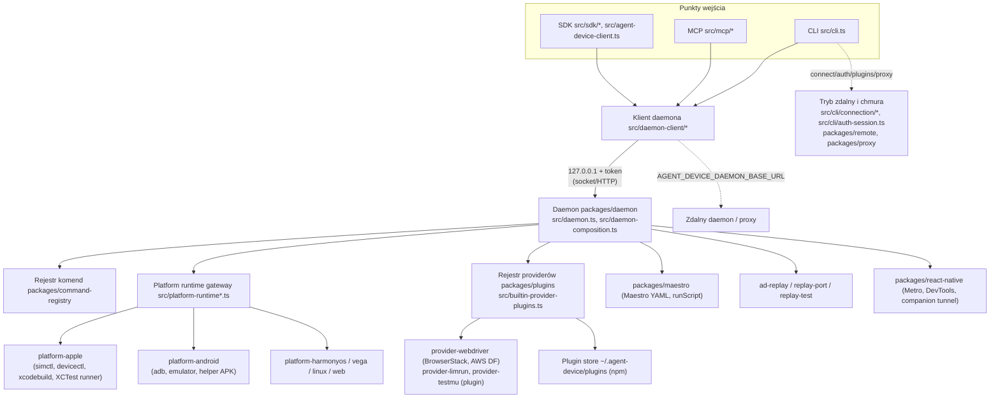

# TapRig — architektura projektu bazowego (agent-device)

Dokument opisuje architekturę `callstack/agent-device` w wersji stanowiącej bazę forka TapRig:
commit `3537dc549a5edb248f918990a137c536fc46ee50` (`package.json` → `0.21.34-dev`). Wnioski
zweryfikowano w kodzie; odniesienia `plik:linia` dotyczą tego commita. Upstream posiada własne
ADR-y w `docs/adr/` (0001–0036) i słownik `CONTEXT.md` — są one źródłem szczegółów, ten dokument
jest mapą pod kątem forka.

## 1. Przegląd

agent-device to narzędzie do automatyzacji aplikacji (iOS, iPadOS, tvOS, visionOS, macOS,
Android, HarmonyOS, Vega/Fire TV, Linux desktop, web) dla agentów AI, w trzech postaciach:

| Powierzchnia | Wejście | Uwagi |
| --- | --- | --- |
| CLI | `bin/agent-device.mjs` → `dist/src/internal/bin.js` (`src/bin.ts`) → `runEntry` (`src/cli/entry.ts:36-64`) → `runCli` (`src/cli.ts:135`) | 75 komend (`agent-device help commands`) |
| Serwer MCP (stdio) | `agent-device mcp` → `src/cli/entry.ts:36,72` → `runAgentDeviceMcpServer` (`src/mcp/server.ts`) | 61 narzędzi; JSON-RPC na stdin/stdout, brak gniazd |
| Node.js SDK | `package.json` → `exports` (`.`, `./io`, `./artifacts`, `./metro`, `./batch`, `./remote-config`, `./install-source`, `./android-adb`, `./limrun`, `./contracts`, `./selectors`, `./finders`, `./ai-sdk`, `./plugins`, `./plugins/webdriver`); wpisy `tsdown.config.ts:96-116` | `createAgentDeviceClient` (`src/agent-device-client.ts:78`), `startAgentDevice`, `ensureDaemon` (`src/sdk/index.ts`) |

Wszystkie trzy powierzchnie są **klientami jednego lokalnego daemona**, który posiada sesje,
urządzenia i zasoby. Daemon uruchamiany jest na żądanie jako odłączony proces Node
(`dist/src/internal/daemon.js`, `src/daemon.ts`).

Repozytorium to monorepo pnpm (`pnpm-workspace.yaml`): katalog główny (paczka `agent-device`) +
31 pakietów `packages/*` (`@agent-device/*`, prywatne, wbudowywane przez `tsdown` w jeden
artefakt — publikowana paczka nie ma `dependencies`) + natywne komponenty `apple/`, `android/`,
`linux/` + `website/` (dokumentacja rspress) + `examples/` + `skills/` (karty dla agentów).

## 2. Diagram zależności

Linie przerywane oznaczają ścieżki przeznaczone do usunięcia lub decyzji w TapRig
(`docs/network-audit.md`, `docs/taprig-decisions.md`).

## 3. CLI

- **Punkt wejścia**: `src/bin.ts` ładuje leniwie `help`, `cli`, `mcp`
  (`src/bin.ts:9-28`). `runEntry` rozpoznaje `mcp` (`src/cli/entry.ts:72`) i omija ścieżkę CLI.
- **Parsowanie i konfiguracja**: `resolveCliOptions` (`src/cli/resolve-cli-options.ts`) —
  argumenty (`src/cli/parser/args.ts`), definicje flag w rejestrze
  (`packages/command-registry/src/flag-definitions-*.ts`), pliki konfiguracji
  `~/.agent-device/config.json` (lub `$AGENT_DEVICE_HOME`), `./agent-device.json` (tylko
  bezpieczne ustawienia projektu), `--config`/`AGENT_DEVICE_CONFIG` (połączenia i poświadczenia).
- **Przebieg** (`src/cli.ts:146-230`): diagnostyka → parsowanie → `resolveRunContextOrExit`
  (binding platformy, domyślne wartości połączenia zdalnego) → komendy specjalne
  (`react-devtools`, `web`) → **update notifier** (`src/cli.ts:198`) → `resolveRemoteContext`
  (auth chmury, materializacja profilu zdalnego, `src/cli.ts:424-480`) → `cdp` →
  `createAgentDeviceClient` → `dispatchCliCommand`.
- **Rejestracja komend**: komendy daemona wynikają z `RAW_COMMAND_DESCRIPTORS`
  (`packages/command-registry/src/registry.ts:411`); komendy wyłącznie klienckie są mapowane w
  `src/cli/commands/router.ts:12-26` (`connect`, `disconnect`, `connection`, `auth`, `plugins`,
  `daemon`, `device`, `proxy`, `takeover`, `replay`, `screenshot`, `diff`, `record`) oraz
  obsługiwane bezpośrednio w `src/cli.ts` (`react-devtools`, `web`, `cdp`).
- **Sesje**: nazwane sesje (`--session`, `AGENT_DEVICE_SESSION`, domyślnie zakres
  workspace+platforma) są własnością daemona; klient przekazuje nazwę.
- **Błędy**: `AppError` z kodami i `details.reason` (`packages/kernel/src/errors.ts`, ADR 0010);
  diagnostyka zapisywana lokalnie (`packages/host-kit/src/internal/diagnostics.ts`).
- **Procesy zewnętrzne**: `@agent-device/host-kit/command` (`runCmd`, `runCmdSync`,
  `runCmdStreaming`, `runCmdDetached`) — jedyna fasada uruchamiania narzędzi.

## 4. Daemon

- **Start**: klient (`src/daemon-client/daemon-client-ensure.ts`, `daemon-launch-spec.ts:33`)
  uruchamia `dist/src/internal/daemon.js`; `src/daemon.ts` → `startDaemonRuntime`
  (`packages/daemon/src/server/http/daemon-runtime.ts:267`) → kompozycja zależności
  `src/daemon-composition.ts:90-203` (providery, gateway platform, inventory, usługi).
- **Komunikacja z klientem**: tryby `socket`, `http`, `dual`
  (`packages/daemon-contracts/src/daemon-resolution.ts:129`); nasłuch **wyłącznie na
  `127.0.0.1`**, port losowy (`packages/daemon/src/server/http/transport.ts:136-160`); token
  i porty publikowane w pliku `daemon.json` w state dir (`~/.agent-device` lub
  `AGENT_DEVICE_STATE_DIR`).
- **Serwer HTTP** (`packages/daemon/src/server/http/http-server.ts:71`): `GET /health`,
  `POST /rpc` (JSON-RPC, wersjonowany protokół — ADR 0006), oraz trasy dla klientów zdalnych:
  upload (`upload-http.ts`, `resumable-upload*.ts`), pobieranie artefaktów
  (`downloadable-artifact-http.ts`), dzierżawy hosta i przejęcia
  (`host-lease-http.ts`, `human-control-http.ts`), diagnostyka (`request-diagnostics-http.ts`),
  autoryzacja i hook auth (`http/http-authorization.ts`).
- **Obsługa żądań**: `createRequestHandler` (`packages/daemon/src/server/request-router.ts:161`)
  → `runRequestHandlerChain` (`packages/daemon/src/sessions/request-handler-chain.ts:128`) →
  handlery sesji (`packages/daemon/src/sessions/handlers/*`).
- **Sesje i urządzenia**: `packages/daemon/src/sessions/*` (cykl życia, replay, obserwowalność),
  `packages/daemon/src/resources/*` (claimy urządzeń, artefakty), `packages/device-selection`.
- **Zasoby**: blokady procesów (ADR 0030), admisja zasobów złożonych (ADR 0036), polityka
  daemona (ADR 0029), sprzątanie (`src/platform-runtime-resource-cleanup.ts`).
- **Komunikacja zewnętrzna daemona**: wyłącznie przez providery chmurowe, pluginy, `runScript`
  użytkownika, pobieranie `install-from-source` i narzędzia platform
  (`docs/network-audit.md`).

## 5. MCP

- **Transport**: stdio (`src/mcp/server.ts:15-34`), odpowiedzi linia po linii (`:167`).
- **Rejestracja narzędzi**: `listMcpCommandMetadata()` (`src/commands/command-metadata.ts`) —
  komendy z rejestru z `mcpExposed` (`packages/command-registry/src/registry.ts:2013-2015`);
  wynik: 61 narzędzi (wszystkie komendy daemona poza `prepare`). Komendy klienckie (`connect`,
  `auth`, `plugins`, `proxy`, `takeover`, `web`, `cdp`, `react-devtools`, `daemon`, `device`)
  **nie są** narzędziami MCP.
- **Wykonanie**: `src/mcp/command-tools.ts` — walidacja wejścia (audience: operator vs model;
  `config`/`remoteConfig` nie są dostępne dla modelu, `:75-90`), utworzenie klienta i wywołanie
  komendy; wynik w formacie zoptymalizowanym lub JSON.
- **Dostęp do chmury**: pośredni — narzędzia działają na zapisanym połączeniu z tego samego
  state dir oraz na konfiguracji operatora (`AGENT_DEVICE_CONFIG`) z `leaseProvider`/
  `daemonBaseUrl`. Narzędzia z potencjalnym ruchem: `install-from-source` (URL), `replay`/`test`
  (runScript), `open` (URL na urządzeniu), `apps`/`artifacts` (katalog i artefakty providera).
- **Update notifier** nie działa w MCP.

## 6. Node.js API (SDK)

- **Eksporty**: patrz §1. Ważne dla forka: `./limrun` (`src/sdk/limrun.ts`), `./plugins`
  (`src/sdk/plugins.ts`), `./plugins/webdriver` (`src/sdk/plugin-webdriver.ts`),
  `./remote-config` (`src/sdk/remote-config.ts`), `./install-source`
  (`src/sdk/install-source.ts`), `./metro` (`src/sdk/metro.ts`).
- **Operacje**: `createAgentDeviceClient(config)` udostępnia te same komendy co CLI/MCP
  (typy `src/client/client-types.ts`); `startAgentDevice` osadza runtime z własnymi
  `providerCandidates` (`src/daemon-composition.ts:81-112`); `ensureDaemon`.
- **Providery w SDK**: `leaseProvider` + pola providera w konfiguracji klienta pomijają stan
  `connect` (pomoc CLI, „Device cloud interfaces”).
- **Kontrakty**: typy publiczne generowane do `dist/src/*.d.ts`; zgodność typów sprawdza
  `@arethetypeswrong/cli`/`publint` w `scripts/check-package.ts`; testy publicznych powierzchni
  `src/sdk/*-public.test.ts`.
- **Kompatybilność wsteczna**: usunięcie eksportów `./limrun`, `./plugins*`, `./remote-config`
  jest zmianą łamiącą — TapRig jako nowa paczka (`0.1.0`) może ją wprowadzić, ale musi to
  udokumentować (D-02).

## 7. Warstwa urządzeń

| Platforma | Pakiet | Mechanizm | Lokalny? |
| --- | --- | --- | --- |
| iOS/iPadOS/tvOS/visionOS — symulator | `packages/platform-apple` | `xcrun simctl`, runner XCTest (`apple/runner`) na `127.0.0.1`, snapshot-bridge, fold-helper | Tak |
| iOS — urządzenie fizyczne | `packages/platform-apple` | `devicectl`, usbmux (`runner-usbmux*.ts`), tunel CoreDevice, `xcodebuild -allowProvisioningUpdates` | Tak (+ usługi Apple przy podpisie) |
| macOS | `packages/platform-apple`, `apple/macos-helper` | Swift helper (budowany lokalnie), AX | Tak |
| Android — emulator/urządzenie | `packages/platform-android` | `adb`, `emulator`, helper APK snapshot/IME (`android/*/dist` w paczce npm), `bundletool` dla `.aab` | Tak |
| HarmonyOS | `packages/platform-harmonyos` | `hdc` | Tak |
| Vega (Fire TV) | `packages/platform-vega` | CLI `vega` | Tak |
| Linux desktop | `packages/platform-linux` | AT-SPI (`linux/atspi-dump.py`) | Tak |
| Web | `packages/platform-web` | `agent-browser` (instalowany przez `web setup`) + Chromium | Tak (strony zewnętrzne = ruch testu) |
| Zdalne urządzenia | `packages/provider-webdriver`, `provider-limrun`, `provider-testmu` | WebDriver / API dostawcy | **Nie** |

Kompozycja platform: `src/platform-runtime.ts`, `src/platform-runtime-gateway.ts:39`,
moduły `src/platform-runtime-*.ts` (host narzędzi, nagrywanie, logi, perf, sieć z logów).

## 8. Pluginy i providery

- **Kontrakt**: `packages/plugins/src/contract.ts` (`AgentDevicePlugin`, `apiVersion: 2`),
  manifest v1 (`packages/plugins/src/manifest.ts`, pole `agentDevicePlugin` w `package.json`).
- **Odkrywanie i ładowanie**: `discoverPluginEntry` (`packages/plugins/src/discovery.ts:26`),
  `storePluginCandidates` + `import()` (`packages/plugins/src/store.ts:77-104`).
- **Instalacja/aktualizacja**: `plugins add|update|remove` → `npm install` do
  `~/.agent-device/plugins/<uuid>` (`store.ts:227-256`), wybór zapisany w `config.json`.
- **Rejestracja**: `resolveProviderPlugins`/`startProviderRegistry`
  (`packages/plugins/src/registry.ts`), z kandydatami wbudowanymi
  (`src/builtin-provider-plugins.ts:20`) i polityką (`src/provider-plugin-policy.ts`).
  Identyfikatory zastrzeżone: `BUILTIN_PROVIDER_IDS` (`src/builtin-provider-ids.ts:18`),
  routing `cloud`, `proxy` (`packages/plugins/src/manifest.ts:7`).
- **Konfiguracja i poświadczenia**: zmienne środowiskowe (`BROWSERSTACK_*`, `LT_*`, Limrun,
  łańcuch AWS CLI), flagi `--provider-*`/`--aws-*`, odcisk poświadczeń przekazywany daemonowi
  (`src/provider-credential-fingerprint.ts`, `src/daemon-composition.ts:24`).
- **Alternatywne ścieżki uruchomienia providera** (muszą zniknąć razem z providerem):
  `connect`, zapisany profil, `--config`/`AGENT_DEVICE_CONFIG`, `--remote-config`, SDK
  `leaseProvider`, `startAgentDevice({ providerCandidates })`, plugin store, zmienne środowiskowe
  Limrun (`docs/network-audit.md` §3.3).

## 9. Replay, Maestro, skrypty

- `.ad` replay: `packages/ad-script` (kodek), `packages/ad-replay` (silnik),
  `packages/replay-port` (adapter daemona), `packages/replay-test` (harmonogram `test`).
- Maestro YAML: `packages/maestro` (ADR 0015 — bezpośredni silnik). `runScript` i `evalScript`
  wykonywane w `node:vm`; `http.post` w procesie potomnym (`docs/network-audit.md` §3.7).
- Dziennik zdarzeń sesji: `packages/session-journal` (ADR 0018).

## 10. React Native

`packages/react-native`: przygotowanie Metro (`metro prepare`, wykrywanie Expo/RN/Re.Pack,
instalacja zależności, start przez `npx`), runtime hints dla aplikacji, `react-devtools`
(inspektor Metro przez WebSocket), most do zdalnego proxy i **companion tunnel** (odłączony
proces tunelujący Metro do zdalnego serwera).

## 11. Budowanie, testy i jakość

- `pnpm install --frozen-lockfile && pnpm build` (`tsdown`, ~15 s; wynik `dist/`).
- Testy: `pnpm test:unit` (vitest, projekty `unit-core` i `fuzz-worker`, ~1830 plików), smoke
  (`pnpm test:smoke`), integracyjne z urządzeniami (`test/integration/*`, wymagają symulatorów/
  emulatorów), `provider-integration` (scenariusze providerów), conformance Maestro.
- Bramki: `pnpm check:quick` (lint + typecheck), `pnpm check:tooling`, `pnpm check:layering`,
  Fallow (martwy kod/eksporty), jscpd, mutation testing (Stryker), budżety rozmiaru.
- Natywne: `pnpm build:xcuitest*` (Xcode), `pnpm build:android` (Android SDK),
  `pnpm build:macos-helper` (Swift).
- CI upstream: `.github/workflows/*.yml` (25 workflowów, w tym publikacja npm i MCP Registry).

## 12. Przepływ wykonania komendy (przykład: `snapshot -i`)

1. `bin/agent-device.mjs` → `src/bin.ts` → `runEntry` → `runCli` (`src/cli.ts:135`).
2. Parsowanie, binding sesji/platformy, (obecnie) update notifier.
3. `createAgentDeviceClient` → `src/daemon-client/daemon-client.ts`: zapewnienie daemona
   (`daemon-client-ensure.ts`), odczyt `daemon.json`, połączenie z `127.0.0.1:<port>` z tokenem.
4. Daemon: `POST /rpc` (lub socket) → `createRequestHandler` → admisja i blokady →
   `runRequestHandlerChain` → handler snapshot → gateway platformy.
5. Platforma: np. iOS — runner XCTest (`runner-transport.ts:142`) lub snapshot-source; Android —
   helper APK przez `adb`.
6. Wynik → formatowanie (`src/commands/cli-output.ts`) → stdout.
