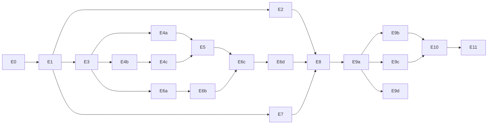

# TapRig — plan implementacji

Plan przekształcenia `callstack/agent-device` (commit bazowy
`3537dc549a5edb248f918990a137c536fc46ee50`) w TapRig — narzędzie local-first do automatyzacji
urządzeń mobilnych. Plan jest przeznaczony dla niezależnych agentów pracujących w osobnych
sesjach, bez dostępu do historii rozmów. Przed rozpoczęciem dowolnego etapu przeczytaj:
`AGENTS.md` (zasady upstream), `docs/HANDOFF.md`, `docs/network-audit.md`,
`docs/taprig-decisions.md`, `docs/architecture.md`.

## 0. Zasady wspólne dla wszystkich etapów

1. **Jeden etap = jeden cel = jeden PR** (lub kilka PR oznaczonych `E4a`, `E4b`…). Gałąź:
   `taprig/e<N>[<litera>]-<krótki-opis>` od aktualnego `main` w `rtnk/TapRig`. PR do `main`.
2. **Wykonuj tylko przydzielony etap.** Nie uruchamiaj kolejnego etapu automatycznie.
3. **Decyzje `NEEDS OWNER DECISION`** (`docs/taprig-decisions.md`) — jeżeli etap od nich zależy,
   a decyzja nie ma statusu ACCEPTED, zatrzymaj się i zapytaj właściciela (albo zrealizuj
   wariant rekomendowany tylko, gdy właściciel to zlecił w treści zadania).
4. **Weryfikacja przed PR** (minimum, w tej kolejności):
   `pnpm install --frozen-lockfile && pnpm build`, `pnpm check:quick` (lint + typecheck),
   `pnpm test:unit`, `pnpm check:layering`, `pnpm check:production-exports`,
   `pnpm check:package` (gdy zmieniasz eksporty/pliki paczki), strażnik sieci (od E1:
   `pnpm taprig:network-guard`), harness offline (od E1: `pnpm taprig:offline-smoke`, Linux).
   Znane, środowiskowe niepowodzenia testów jednostkowych opisuje `docs/HANDOFF.md` —
   porównuj z tym baseline'em, nie ukrywaj nowych błędów.
5. **Nie wyłączaj, nie pomijaj i nie dodawaj do allowlist testów/bramek**, aby uzyskać zielone CI
   (zasada upstream `AGENTS.md`: „Resolve a gate failure at the reported invariant”). Usuwając
   funkcję, usuwasz też jej testy, wpisy w baseline'ach Fallow (`fallow-baselines/`,
   `.fallowrc.json`), regułach warstw (`scripts/layering/*`), macierzy możliwości
   (`scripts/capability-matrix/*`), `tsconfig.typecheck.json`, `examples/sdk/tsconfig.json`,
   dokumentacji pomocy (`src/commands/schema/cli-help.ts`, `command-overrides.ts`) i
   `website/docs/**`.
6. **Aktualizuj dokumentację TapRig**: tabela w `docs/network-audit.md` (kolumna „Decyzja” →
   dopisz „DONE w E<N>, PR #…”), `docs/taprig-decisions.md` (status), `docs/HANDOFF.md`
   (stan, następny etap, prompt dla kolejnego agenta).
7. **Numery linii** w dokumentach odnoszą się do commita bazowego — lokalizuj kod po nazwach
   symboli (`git grep`).
8. **Commity**: konwencja upstream (`type(scope): opis`), bez identyfikatorów modeli AI w treści.

## 1. Mapa etapów

| ID | Cel | Zależy od | Decyzje | Złożoność |
| --- | --- | --- | --- | --- |
| E0 | Eksploracja, audyt, plan, handoff | — | — | — (zrobione) |
| E1 | Fundament forka: atrybucja, CI forka, strażnik sieci, harness offline (bez zmian zachowania) | E0 | D-01, D-10 (część: wyłączenie publikacji), D-12, D-18 | M |
| E2 | Usunięcie sprawdzania aktualizacji (NET-01) | E1 | D-03 | S |
| E3 | Usunięcie chmury agent-device: `auth`, profil `cloud`, domyślny `connect` (NET-02/03) | E1 | D-03 | M |
| E4a | Usunięcie providera Limrun (NET-07) | E3 | D-03 | L |
| E4b | Usunięcie BrowserStack i AWS Device Farm (`provider-webdriver`) (NET-04/05) | E3 | D-03 | L |
| E4c | Usunięcie TestMu AI (`provider-testmu`) (NET-06) | E4b | D-03 | S |
| E5 | Usunięcie systemu pluginów i infrastruktury providerów (NET-08/09) | E4a–c | D-13 | M |
| E6a | Usunięcie komendy `proxy` i `packages/proxy` (NET-14) | E3 | D-04 | M |
| E6b | Usunięcie mostu Metro i companion tunnel (NET-16/17) | E6a | D-04 | M |
| E6c | Usunięcie klienta zdalnego: `connect`/`connection`/`disconnect`/`takeover`, `packages/remote`, `--daemon-base-url`, `--github-actions-artifact` (NET-10–13, 15, 23) | E4a–c, E5, E6a, E6b | D-04, D-06 | XL |
| E6d | Usunięcie endpointów daemona dla zdalnych klientów i dzierżaw zdalnych | E6c | D-19 | L |
| E7 | Ograniczenie niejawnych pobrań: Metro, `cdp`, `web setup`, `install-from-source` (NET-18–22), opt-out provisioningu (NET-24) | E1 (niezależny od E4–E6) | D-06, D-07, D-08, D-09, D-14 | M |
| E8 | Polityka local-only: finalna allowlista, testy dynamiczne, test HTTP w skrypcie użytkownika, dokumentacja użytkownika | E2–E7 | D-11, D-12 | M |
| E9a | Rebranding: tożsamość publiczna (paczka, binarka, MCP, pomoc, README) | E8 (lub zaraz po E1 — D-16) | D-02, D-15 | M |
| E9b | Rebranding: zmienne środowiskowe i katalog stanu (z fallbackiem) | E9a | D-02, D-15 | M |
| E9c | Rebranding: dokumentacja, `skills/`, `website/` | E9a | D-15 | M |
| E9d | (opcjonalnie) Rebranding identyfikatorów natywnych | E9a | D-15 | M |
| E10 | Pełna regresja CLI, MCP, iOS, Android (z raportami ruchu sieciowego) | E8, E9a–c | — | L |
| E11 | CI/CD i wydanie 0.1.0 | E10 | D-10, D-18 | M |

Kolejność różni się od wstępnej propozycji: rebranding przeniesiono za usunięcia (D-16).
E7 jest niezależny i może być realizowany równolegle z E4–E6 (inne pliki).

## 2. Mapa zależności komponentów do usunięcia

| Komponent | Zależą od niego (poza testami) | Ryzyko usunięcia |
| --- | --- | --- |
| `src/cli/update-check*.ts` | `src/cli.ts:48,198`, `tsdown.config.ts:116`, `scripts/check-package.ts`, `test/repo-guards/npm-package-scripts.test.ts`, skrypty benchmarków (`scripts/ios-snapshot-benchmark/*`, `scripts/lib/bench-host.ts` — ustawiają `AGENT_DEVICE_NO_UPDATE_NOTIFIER`) | Niskie |
| Chmura agent-device (`auth-session.ts`, `cloud-profile.ts`, `cloud-response.ts`, `browser-launch.ts`, `commands/auth.ts`) | `src/cli.ts:53,436` (`resolveRemoteAuthForCli`), `src/cli/commands/router.ts:16`, `connect-provider-adapters.ts:11,60`, `packages/contracts/src/lease-scope.ts:8` (`CLOUD_LEASE_PROVIDER`), `packages/plugins/src/manifest.ts:7` (`'cloud'`), `packages/remote/src/remote-connection-state.ts` | Średnie — `resolveRemoteContext` w `src/cli.ts` łączy auth z materializacją profilu zdalnego |
| `packages/provider-limrun` + `src/provider-limrun-*`, `src/sdk/limrun*`, `src/vendor/limrun-delta-sync-omitted.ts` | `src/builtin-provider-plugins.ts`, `src/builtin-provider-ids.ts`, `connect-provider-adapters.ts`, `src/cli/connection/limrun-profile.ts`, eksport `./limrun`, `tsdown.config.ts` (`dropAmbientDeclarationImport` dla `@limrun/api`), `pnpm-workspace.yaml` (override `undici`, `minimumReleaseAgeExclude`), typy współdzielone (`'limrun-ios-tree'` w `packages/contracts/src/ios-snapshot.ts:14-19`, `packages/kernel/src/snapshot.ts:583`, `packages/capture-kit/src/ios-snapshot-acquisition.ts:40-66`), `src/commands/capture/*`, `src/commands/system/index.ts`, `packages/maestro/src/internal/support-matrix.ts`, `packages/daemon/src/server/request-diagnostics-http.ts` | **Wysokie** — przecięcia z kodem snapshotów iOS i alertów; ryzyko zepsucia ścieżek lokalnych iOS |
| `packages/provider-webdriver` | `src/builtin-provider-*.ts`, `src/provider-webdriver.ts`, `src/provider-plugin-policy.ts`, `src/sdk/plugin-webdriver.ts`, `src/sdk/plugins.ts`, `packages/contracts/src/device-provider.ts`, `packages/provider-testmu`, flagi `--provider-*`/`--aws-*` (`packages/command-registry/src/flag-definitions-connection.ts`), `packages/command-registry/src/timeout-policy.ts`, `src/commands/management/artifacts.ts`, typ `'appium-source'` | **Wysokie** — flagi połączeń i typy `appium-source` używane w snapshotach |
| `packages/provider-testmu` | katalog `src/commands/provider-plugin-catalog.ts`, pomoc, `scripts/capability-matrix/collect.ts`, `scripts/layering/*`, `.fallowrc.json`, `package.json` (devDependency), `tsconfig.typecheck.json`, `examples/sdk/tsconfig.json` | Niskie |
| `packages/plugins` (store, loader, discovery) | `src/provider-device-runtimes.ts`, `src/builtin-provider-plugins.ts`, `src/cli/commands/plugins.ts`, `src/cli/connection/*`, `src/provider-credential-fingerprint.ts`, `src/daemon-composition.ts`, eksporty `./plugins`, `./plugins/webdriver`, `packages/contracts/src/plugin-inventory*`, `packages/daemon-contracts` (inwentarz pluginów w rekordzie daemona), komenda `daemon status` (lista providerów) | Średnie — rejestr providerów jest częścią kompozycji daemona |
| `packages/proxy` + `src/cli/commands/proxy.ts`, `proxy-lease-device.ts` | `packages/daemon/src/core/session-tenant-scope.ts` (komentarz/typy), router CLI | Średnie |
| `packages/react-native/src/companion/*`, bridge w `client-metro.ts` | `metro prepare`, wpis `internal/companion-tunnel` w `tsdown.config.ts:112`, flagi `--metro-proxy-base-url`, `--metro-bearer-token`, `--metro-public-base-url`, `src/commands/metro/*` | Średnie — nie naruszyć lokalnego `metro prepare`/`reload` |
| `packages/remote` + klient zdalny | `src/cli.ts` (`resolveRemoteContext`, `REMOTE_MATERIALIZATION_DEFERRED_COMMANDS`, ended-lease), `src/daemon-client/daemon-client.ts:17-19`, `daemon-client-rpc.ts:12-13,165-167`, `daemon-client-lifecycle.ts:139,190`, `src/cli/commands/connection*.ts`, `src/cli/connection/*`, `src/cli/remote-config-flags.ts`, `src/sdk/remote-config.ts`, eksport `./remote-config`, `install-from-source --github-actions-artifact` (`packages/provision-kit/src/install-source-config.ts`, `packages/daemon/src/server/http/http-rpc-methods.ts:83-215`) | **Bardzo wysokie** — klient daemona jest wspólny dla lokalnego i zdalnego trybu |
| Endpointy zdalne daemona (`upload*`, `resumable-upload*`, `downloadable-artifact-http.ts`, `host-lease-http.ts`, `human-control-http.ts`, `request-diagnostics-http.ts`, hook auth, `lease*`) | `packages/daemon/src/server/http/http-server.ts`, `request-router.ts`, sesje i zasoby (`lease-registry.ts`), runner Apple (`runner-lease.ts` — dzierżawy runnera są lokalne!) | **Wysokie** — „lease” oznacza też lokalne dzierżawy runnera Apple; usuwać tylko dzierżawy providerów zdalnych |

---

## 3. Etapy szczegółowo

### E1 — Fundament forka i zabezpieczenia (bez zmian zachowania)

- **Cel**: przygotować repozytorium TapRig do pracy etapami: atrybucja, CI forka, automatyczna
  kontrola polityki sieciowej (stan bazowy) — bez zmiany zachowania narzędzia.
- **Zakres**: dokumentacja, `.github/workflows`, nowe skrypty `scripts/taprig/*`, `package.json`
  (tylko nowe skrypty), test strażnika.
- **Zależności**: E0 (dokumenty), `main` = commit bazowy.
- **Pliki**:
  - nowe: `NOTICE`, `docs/upstream-sync.md`, `scripts/taprig/network-guard.ts`,
    `scripts/taprig/network-allowlist.json`, `scripts/taprig/network-guard.test.ts` (włączony do
    projektu vitest `unit-core` — sprawdź `vitest.config.ts`, jakie wzorce `include` obejmują
    `scripts/__tests__`/`scripts/**`), `scripts/taprig/offline-harness/{lo_up.py,run.sh,check.mjs,README.md}`;
  - zmieniane: `README.md` (baner „TapRig — fork agent-device, local-first; praca w toku”,
    link do NOTICE i dokumentów), `LICENSE` (dodatkowa linia copyright TapRig — treść MIT bez
    zmian), `package.json` (skrypty `taprig:network-guard`, `taprig:offline-smoke`),
    `.github/workflows/*.yml`.
- **Zadania**:
  1. `NOTICE`: pochodzenie (URL upstream, commit bazowy, licencja MIT, Callstack), opis forka.
  2. `docs/upstream-sync.md`: remote `upstream`, procedura merge (D-01), obowiązkowe kontrole
     po merge'u (strażnik + harness), lista obszarów kolizji (moduły usuwane w E2–E6).
  3. CI forka: wyłączyć (usunąć lub zostawić tylko `workflow_dispatch` z warunkiem
     `github.repository == 'rtnk/TapRig'` i bez kroków publikacji) workflowy upstream:
     `release.yml`, `publish-mcp-registry.yml`, `release-android-snapshot-helper.yml`,
     `release-ios-runner.yml`, `deploy.yml`, `pr-preview.yml`, `pr-preview-cleanup.yml`,
     harmonogramy nightly (`*-nightly.yml`, `conformance-*.yml`, `mutation-weekly.yml`,
     `perf-nightly.yml`). Zachować `ci.yml` (lint, typecheck, unit, build) — sprawdzić, czy nie
     wymaga sekretów/self-hosted runnerów; jeśli wymaga — dostosować do `ubuntu-latest`.
     Udokumentować w PR, co wyłączono i dlaczego (D-10).
  4. Strażnik statyczny (`docs/network-audit.md` §7.1, punkty 1–3): skan plików produkcyjnych
     (`git ls-files src packages bin` z wyłączeniem testów/fixture'ów — reguły jak w audycie §1),
     wykrywanie prymitywów sieciowych, literałów URL i wywołań `runCmd*` z `npm`/`npx`/`curl`/
     `aws` itp.; porównanie z `network-allowlist.json` (wpis: `file`, `pattern`/`symbol`,
     `id` (NET-xx), `decision`, `reason`). Baseline = wszystkie obecne miejsca (NET-01…NET-38).
     Test failuje dla miejsca spoza allowlisty i dla wpisu allowlisty, którego już nie ma
     (allowlista musi się kurczyć razem z kodem).
  5. Harness dynamiczny (`docs/network-audit.md` §6–7.2): skrypt uruchamiający komendę w
     `unshare -n` z `strace`, parser logu (naruszenie = `connect`/`sendto` AF_INET/AF_INET6 do
     adresu spoza `127.0.0.0/8`/`::1`), scenariusze: `--version`, `help`, `devices --platform
     android` (z TTY przez `script` i bez, czysty state dir), `mcp` (initialize + tools/list).
     Oczekiwany wynik w E1: **jedno znane naruszenie NET-01** (scenariusz TTY) — oznaczone w
     pliku oczekiwań jako „expected until E2”; harness failuje, gdy pojawi się inne naruszenie
     albo gdy oczekiwane zniknie (wymusza aktualizację w E2).
  6. Job CI `taprig-offline` (Linux, `sudo unshare`), uruchamiany w PR.
- **Kryteria akceptacji**: brak zmian w `src/`, `packages/`, `bin/` (poza ewentualnym
  `package.json` → `scripts`); `pnpm build` i `pnpm test:unit` dają ten sam wynik co baseline;
  strażnik i harness przechodzą w CI; wyłączone workflowy nie publikują niczego; NOTICE i
  LICENSE zachowują notę Callstack.
- **Testy**: `pnpm taprig:network-guard`, `pnpm taprig:offline-smoke`, `pnpm check:quick`,
  `pnpm test:unit`; ręcznie: dodanie tymczasowego `fetch('https://example.com')` w pliku `src/`
  powoduje błąd strażnika (nie commitować).
- **Ryzyka**: `strace`/`unshare` niedostępne na runnerze (użyć `sudo apt-get install strace`
  w CI — to ruch budowania, nie runtime); fałszywe alarmy strażnika (komentarze z URL — reguła
  ignorowania komentarzy JSDoc z linkami do issue upstream musi być jawna w allowliście).
- **Rezultat PR**: „E1: fork foundation — attribution, fork CI, network guard baseline, offline
  harness”.

### E2 — Usunięcie sprawdzania aktualizacji (NET-01)

- **Cel**: TapRig nie łączy się z rejestrem npm i nie uruchamia workera aktualizacji.
- **Zakres/pliki**: usunąć `src/cli/update-check.ts`, `src/cli/update-check-entry.ts`,
  `src/cli/__tests__/update-check.test.ts`; `src/cli.ts` (import `:48`, wywołanie `:198`);
  `tsdown.config.ts` (wpis `internal/update-check-entry`); `scripts/check-package.ts` i
  `test/repo-guards/npm-package-scripts.test.ts` (oczekiwane pliki `dist`); odwołania do
  `AGENT_DEVICE_NO_UPDATE_NOTIFIER` w `scripts/ios-snapshot-benchmark/*`,
  `scripts/lib/bench-host.ts`, `scripts/check-provider-plugin.mjs`,
  `src/cli/commands/__tests__/plugins.test.ts`, `.fallowrc.json`; dokumentacja
  `website/docs/docs/{configuration,installation,security-trust}.md`.
- **Kryteria akceptacji**: brak `registry.npmjs.org` w `src/`, `packages/`, `dist/`; brak pliku
  `update-check-entry.js` w `dist/`; harness: scenariusz TTY bez naruszeń (usunąć oczekiwanie
  NET-01); allowlista bez NET-01.
- **Testy**: jak w §0 p.4 + harness; test jednostkowy, że `runCli` z TTY nie tworzy
  `update-check.json` (można zastąpić istniejący test).
- **Ryzyka**: niskie; testy CLI mogą zakładać istnienie zmiennej opt-out.
- **Złożoność**: S.

### E3 — Usunięcie chmury agent-device (NET-02, NET-03)

- **Cel**: brak logowania do `cloud.agent-device.dev`, brak profilu `cloud`, `connect` bez
  providera zwraca błąd.
- **Pliki**: usunąć `src/cli/auth-session.ts`, `src/cli/cloud-response.ts`,
  `src/cli/browser-launch.ts` (sprawdzić innych użytkowników `git grep browser-launch`),
  `src/cli/connection/cloud-profile.ts`, `src/cli/commands/auth.ts` i testy
  (`src/cli/__tests__/auth-session.test.ts`, `browser-launch.test.ts`,
  `src/cli/commands/__tests__/auth.test.ts`, `src/__tests__/cloud-connect-auth.test.ts`,
  `cloud-connect-profile*.test.ts` — część dotycząca `cloud`); zmienić `src/cli.ts`
  (`resolveRemoteAuthForCli` — zostawić tylko token z flagi/env do czasu E6c),
  `src/cli/commands/router.ts` (usunąć `auth`), `src/cli/connection/connect-provider-adapters.ts`
  (usunąć adapter `cloud`, domyślny provider → błąd `INVALID_ARGS` „connect requires a
  provider”), `packages/plugins/src/manifest.ts:7` (usunąć `'cloud'`),
  `packages/contracts/src/lease-scope.ts` (`CLOUD_LEASE_PROVIDER` — sprawdzić użycia),
  `packages/remote/src/remote-connection-state.ts`, rejestr komend (descriptor `auth`, jeśli
  istnieje w `packages/command-registry`), pomoc (`cli-help.ts` „Cloud profile flow”,
  `command-overrides.ts`), zmienne `AGENT_DEVICE_CLOUD_AUTH`, `AGENT_DEVICE_CLOUD_BASE_URL`,
  `website/docs/docs/{commands,configuration}.md`, `fallow-baselines/health.json`.
- **Kryteria akceptacji**: `agent-device auth` → nieznana komenda lub błąd local-only (D-02);
  `agent-device connect` (bez argumentów, z tokenem w env) → błąd bez żadnego połączenia
  (harness); brak `agent-device.dev` w kodzie produkcyjnym i `dist/` (poza linkami
  dokumentacyjnymi oznaczonymi w allowliście, które usuwa E9).
- **Testy**: §0 p.4; harness: nowy scenariusz `connect` z `AGENT_DEVICE_DAEMON_AUTH_TOKEN` —
  zero połączeń.
- **Ryzyka**: `resolveRemoteContext` obsługuje też `connect proxy` i providery — nie usuwać
  ścieżek innych niż `cloud` (zrobi to E6c).
- **Złożoność**: M.

### E4a — Usunięcie providera Limrun (NET-07)

- **Cel**: brak kodu Limrun, zależności `@limrun/api`, eksportu `./limrun`.
- **Pliki**: usunąć `packages/provider-limrun/`, `src/provider-limrun-credentials.ts`,
  `src/provider-limrun-runtime.ts`, `src/sdk/limrun*.ts`, `src/vendor/limrun-delta-sync-omitted.ts`,
  `src/cli/connection/limrun-profile.ts`, `src/daemon-runtime-limrun-public-http.test.ts`,
  testy `src/__tests__/*limrun*`, `test/integration/limrun-public-types.test.ts`,
  `test/integration/provider-scenarios/limrun-*`; zmienić `src/builtin-provider-plugins.ts`
  (usunąć `limrunCandidate`), `src/builtin-provider-ids.ts` (`LIMRUN_ID`, `LIMRUN_CONNECTION`),
  `connect-provider-adapters.ts` (adapter `limrun`, `verifyLimrun`), `package.json` (`exports`
  `./limrun`, devDependencies `@limrun/api`, `@agent-device/provider-limrun`),
  `tsdown.config.ts` (wpis `limrun`, `dropAmbientDeclarationImport`), `pnpm-workspace.yaml`
  (`minimumReleaseAgeExclude` dla `@limrun/api`; override `undici@7` — zostawić, jeśli
  `undici` nadal używany przez `run-script-http.ts`/`provision-kit`), `pnpm-lock.yaml`
  (`pnpm install`), `tsconfig.typecheck.json`, `examples/sdk/tsconfig.json`, `.fallowrc.json`,
  `scripts/layering/*`, `scripts/capability-matrix/*`, `scripts/__tests__/package-closure-audit.test.ts`,
  `test/repo-guards/package-exports.test.ts`, pomoc. Typy współdzielone: zawęzić
  `'limrun-ios-tree'` (`packages/contracts/src/ios-snapshot.ts`, `packages/kernel/src/snapshot.ts`,
  `packages/capture-kit/src/ios-snapshot-acquisition.ts`) — w osobnym commicie.
  Uwaga: wiele testów w `packages/daemon`, `packages/contracts`, `packages/capture-kit` używa
  napisu `limrun` jako przykładowego providera w fixture'ach — zastąpić neutralnym providerem
  testowym, nie usuwać testów zachowań lokalnych.
- **Kryteria akceptacji**: `git grep -il limrun -- src packages` zwraca wyłącznie wpisy
  świadomie pozostawione (lista w PR, docelowo zero); `dist/` nie zawiera kodu `@limrun/api`;
  `pnpm check:package` przechodzi; testy snapshotów iOS (lokalnych) przechodzą bez zmian
  semantyki.
- **Testy**: §0 p.4, `pnpm check:production-exports`, `pnpm typecheck` (w tym
  `examples/sdk`), testy `packages/capture-kit` i `packages/platform-apple`.
- **Ryzyka**: wysokie — przecięcia z kodem snapshotów/alertów iOS; regresje typów.
- **Złożoność**: L.

### E4b — Usunięcie BrowserStack i AWS Device Farm (NET-04, NET-05)

- **Cel**: brak wbudowanych providerów WebDriver i pakietu `provider-webdriver`.
- **Pliki**: usunąć `packages/provider-webdriver/`, `src/provider-webdriver.ts` (+ test),
  `src/sdk/plugin-webdriver.ts` (eksport `./plugins/webdriver`),
  `test/integration/provider-scenarios/cloud-webdriver-*`, `bundled-cloud-webdriver-runtimes.ts`,
  `test/integration/smoke-provider-cli-disconnect.test.ts` (część webdriver),
  `test/integration/support/provider-disconnect-fetch.mjs`; zmienić `src/builtin-provider-ids.ts`
  i `src/builtin-provider-plugins.ts` (bez kandydatów WebDriver), `src/provider-plugin-policy.ts`,
  `src/sdk/plugins.ts`, `packages/contracts/src/device-provider.ts`,
  `packages/contracts/src/provider-connection.ts`, flagi
  `packages/command-registry/src/flag-definitions-connection.ts` (`--provider-*`, `--aws-*` —
  usunąć te używane wyłącznie przez providery WebDriver/TestMu; w E4c resztę),
  `packages/command-registry/src/timeout-policy.ts`, `src/commands/management/artifacts.ts`
  (artefakty sesji providera), `src/cli/commands/connection-presentation.ts`,
  `connection-runtime.ts`, `src/cli/connection/provider-policy.ts`, pomoc, `package.json`
  (eksport i devDependency), `tsconfig.typecheck.json`, `examples/sdk/tsconfig.json`,
  `scripts/layering/*`, `scripts/capability-matrix/*`, `scripts/help-conformance-*`,
  `fallow-baselines/health.json`. Typ `'appium-source'` (producent snapshotu z WebDriver) —
  zawęzić po usunięciu wszystkich producentów.
- **Uwaga**: `packages/provider-testmu` importuje `@agent-device/provider-webdriver` — usuń go w
  tym samym PR **albo** zrealizuj E4c przed E4b. Rekomendacja: E4c i E4b w jednym ciągu, E4c
  pierwszy, jeśli E4b okaże się zbyt duży.
- **Kryteria akceptacji**: `BUILTIN_PROVIDER_IDS` puste (lub usunięte); brak domen
  `browserstack.com`, `amazonaws`, `devicefarm` w kodzie produkcyjnym i `dist/`; brak wywołań
  `aws` w `runCmd*`; `connect browserstack`/`connect aws-device-farm` → błąd bez połączeń.
- **Testy**: §0 p.4; harness: `connect browserstack` z fikcyjnymi poświadczeniami — zero
  połączeń.
- **Ryzyka**: flagi połączeń są współdzielone z mechanizmem dzierżaw; `artifacts` ma też
  lokalną funkcję (artefakty daemona) — zachować ją.
- **Złożoność**: L.

### E4c — Usunięcie TestMu AI (NET-06)

- **Pliki**: usunąć `packages/provider-testmu/`; zmienić `package.json` (devDependency
  `@agent-device/testmu`), `src/commands/provider-plugin-catalog.ts`, pomoc (`cli-help.ts`
  „TestMu AI … flow”), `packages/daemon/src/sessions/handlers/lease.ts`,
  `packages/command-registry/src/flag-definitions-connection.ts`,
  `scripts/capability-matrix/*`, `scripts/check-provider-plugin.mjs`, `scripts/layering/*`,
  `.fallowrc.json`, `tsconfig.typecheck.json`, `examples/sdk/tsconfig.json`, testy
  (`src/__tests__/cloud-connect-testmu.test.ts` itd.).
- **Kryteria akceptacji**: brak `lambdatest`/`testmu` w kodzie produkcyjnym i `dist/`;
  katalog pluginów pusty.
- **Złożoność**: S.

### E5 — Usunięcie systemu pluginów i infrastruktury providerów (NET-08, NET-09)

- **Warunek**: decyzja D-13 (rekomendacja: usunąć całość).
- **Cel**: brak `plugins add/update` (npm), brak ładowania kodu z `~/.agent-device/plugins`
  przy starcie daemona, brak eksportu `./plugins`.
- **Pliki**: `src/cli/commands/plugins.ts` (+ router), `packages/plugins/src/{store,discovery,
  legacy,load,connection}.ts`, `src/provider-device-runtimes.ts` (kompozycja bez store'a),
  `src/builtin-provider-plugins.ts`, `src/builtin-provider-ids.ts`, `src/provider-plugin-policy.ts`,
  `src/provider-credential-fingerprint.ts`, `src/daemon-composition.ts` (parametr
  `providerCandidates`, `createDaemonProviderRuntimeComposition`), `src/sdk/plugins.ts`,
  `src/sdk/index.ts` (`startAgentDevice` — opcja `providerCandidates`),
  `src/commands/provider-plugin-catalog.ts`, `packages/contracts/src/plugin-inventory*`,
  `packages/daemon-contracts` (pole `plugins` rekordu daemona), `src/cli/commands/daemon.ts`
  (wypisywanie providerów), pomoc „Plugin installation”.
- **Kryteria akceptacji**: brak `npm` w wywołaniach `runCmd*` pakietu `plugins`; daemon nie
  czyta `~/.agent-device/plugins`; SDK nie pozwala wstrzyknąć providera zdalnego; testy
  przechodzą.
- **Ryzyka**: zgodność wire protokołu daemona (`pnpm check:daemon-wire-compat`) — pole
  `plugins` w rekordzie; ADR 0034. Daemon musi nadal startować bez rejestru providerów.
- **Złożoność**: M.

### E6a — Usunięcie komendy `proxy` i `packages/proxy` (NET-14)

- **Warunek**: D-04 = (a).
- **Pliki**: `src/cli/commands/proxy.ts`, `src/cli/commands/proxy-lease-device.ts`, router,
  `packages/proxy/`, flagi `--proxy-host`, `--proxy-port`, `--daemon-auth-token` (tylko jeśli
  nie jest używana gdzie indziej — sprawdzić), pomoc „Direct proxy flow”, `package.json`.
- **Kryteria akceptacji**: brak komendy `proxy`; nic nie słucha poza `127.0.0.1`
  (`git grep "listen("` w kodzie produkcyjnym — tylko loopback).
- **Złożoność**: M.

### E6b — Usunięcie mostu Metro i companion tunnel (NET-16, NET-17)

- **Pliki**: `packages/react-native/src/companion/*`, fragmenty bridge w
  `packages/react-native/src/metro/client-metro.ts` (`configureMetroBridge*`,
  `configureProxyBridge*`, `resolveProxySettings`, ngrok), wpis `internal/companion-tunnel` w
  `tsdown.config.ts`, flagi `--metro-proxy-base-url`, `--metro-bearer-token` (sprawdzić
  `metroPublicBaseUrl` — może być potrzebny lokalnie), `src/commands/metro/*`, pomoc.
- **Kryteria akceptacji**: `metro prepare` i `metro reload` działają lokalnie (testy
  `packages/react-native`, `test/integration/installed-package-metro.test.ts`); brak procesu
  companion; brak `WebSocket` do hostów zdalnych.
- **Złożoność**: M.

### E6c — Usunięcie klienta zdalnego i komend połączeń (NET-10–13, 15, 23)

- **Warunek**: D-04 = (a); po E4–E5, E6a, E6b.
- **Pliki**: `packages/remote/`, `src/cli/commands/{connection,connection-context,
  connection-presentation,connection-runtime,takeover,remote-bridge}.ts`, `src/cli/connection/*`,
  `src/cli/remote-config-flags.ts`, `src/sdk/remote-config.ts` (eksport `./remote-config`),
  `src/cli.ts` (`resolveRemoteContext`, `REMOTE_MATERIALIZATION_DEFERRED_COMMANDS`,
  `forgetEndedProxyLease`, ostrzeżenia remote), `src/daemon-client/*` (gałęzie `baseUrl`,
  `isRemoteDaemon`, `materializeRemoteArtifacts`, `prepareRemoteRequestArtifacts`,
  `localizeRemoteDaemonError`, `AGENT_DEVICE_DAEMON_BASE_URL`), flagi `--daemon-base-url`,
  `--daemon-auth-token`, `--remote-config`, `--tenant`, `--run-id`, `--lease-*` (te, które nie
  mają lokalnego znaczenia — sprawdzić w rejestrze flag), `--github-actions-artifact`
  (`packages/provision-kit/src/install-source-config.ts`, `src/commands/management/install.ts`,
  `packages/daemon/src/server/http/http-rpc-methods.ts`, `packages/kernel/src/contracts.ts`),
  pomoc „remote”, testy `src/__tests__/remote-connection*.test.ts`,
  `test/integration/remote-connection-process-isolation.test.ts`, MCP
  (`src/mcp/command-tools.ts` — klucz `remoteConfig`).
- **Kryteria akceptacji**: klient łączy się wyłącznie z lokalnym daemonem przez
  `127.0.0.1`/socket; brak `https` w transporcie klienta; `AGENT_DEVICE_DAEMON_BASE_URL`
  ignorowana z ostrzeżeniem lub błędem (D-02); pliki konfiguracji z `daemonBaseUrl`/
  `leaseProvider` zwracają czytelny błąd; MCP i SDK nie mają ścieżki do zdalnego daemona.
- **Testy**: §0 p.4; `pnpm check:daemon-wire-compat`; harness: komenda z
  `AGENT_DEVICE_DAEMON_BASE_URL=https://example.invalid` → zero połączeń.
- **Ryzyka**: bardzo wysokie (klient daemona jest wspólny); dzielić na commity: (1) CLI
  komendy, (2) klient daemona, (3) pakiet `remote`, (4) flagi i pomoc.
- **Złożoność**: XL (rozważyć dwa PR: E6c-1 komendy i konfiguracja, E6c-2 klient i pakiet).

### E6d — Endpointy daemona dla zdalnych klientów (D-19)

- **Pliki** (do potwierdzenia analizą użycia): `packages/daemon/src/server/{upload-http,upload,
  resumable-upload,resumable-upload-range,resumable-upload-transfer,downloadable-artifact-http,
  artifact-download,host-lease-http,human-control-http,request-diagnostics-http,
  provider-lease-expiry}.ts`, `packages/daemon/src/server/http/http-authorization.ts` (hook
  auth), `packages/daemon/src/sessions/handlers/{lease,human-control}.ts`,
  `packages/daemon/src/resources/lease-registry.ts` (tylko dzierżawy providerów; **nie**
  dzierżawy runnera Apple `packages/platform-apple/src/runner/runner-lease.ts`), komendy
  rejestru związane z dzierżawami.
- **Kryteria akceptacji**: daemon obsługuje tylko `/health` i `/rpc` (+ to, czego używa
  lokalny klient — wypisać w PR); testy lokalnych sesji, nagrań i artefaktów przechodzą.
- **Złożoność**: L.

### E7 — Ograniczenie niejawnych pobrań (NET-18–22, NET-24)

- **Warunki**: D-06, D-07, D-08, D-09, D-14 (realizować tylko zaakceptowane warianty; D-08 i
  D-09 są PROPOSED — wymagają akceptacji w przeglądzie PR).
- **Pliki**: `packages/react-native/src/metro/client-metro.ts` (instalacja zależności
  opt-in, `npx --no-install`), flagi Metro w `packages/command-registry`,
  `src/cli/commands/agent-cdp.ts` (bez `npm exec --yes`), `packages/platform-web/src/
  agent-browser-{install,tool}.ts` (tryb offline), `packages/provision-kit/src/
  install-source*.ts` + `src/commands/management/install.ts` (allowlista hostów),
  `packages/platform-apple/src/runner/runner-artifact.ts:892` (opt-out provisioningu), pomoc i
  `website/docs`.
- **Kryteria akceptacji**: żadna komenda poza `web setup` (i ewentualnie jawną flagą
  instalacji zależności Metro) nie uruchamia `npm`/`npx`/`pnpm`/`yarn` mogących pobierać
  paczki; strażnik statyczny potwierdza.
- **Złożoność**: M (można podzielić: E7-metro, E7-cdp, E7-web, E7-install-source).

### E8 — Polityka local-only i dowody

- **Cel**: zamknąć allowlistę, dodać pełne testy dynamiczne i dokumentację dla użytkownika.
- **Pliki**: `scripts/taprig/network-allowlist.json` (tylko PRESERVE/RESTRICT),
  `scripts/taprig/offline-harness/*` (scenariusze: `devices`, `doctor`, `mcp` z `tools/call`,
  `replay` przepływu Maestro z `runScript`, `daemon status/stop`, uruchomienia z TTY i bez),
  nowy test pozytywny: przepływ Maestro `runScript` z `http.post` do lokalnego serwera
  testowego (serwer otrzymuje żądanie, `output.*` zawiera odpowiedź) uruchamiany w harnessie;
  wariant z serwerem w drugim namespace (veth) pod adresem spoza loopback, ruch atrybuowany do
  `run-script-http-child` i oznaczony jako dozwolony; `docs/network-policy.md` (dla
  użytkowników: co TapRig robi w sieci, co jest ruchem aplikacji/skryptu/budowania).
- **Kryteria akceptacji**: strażnik bez wpisów REMOVE; harness zielony; test HTTP skryptu
  użytkownika zielony; raport z harnessu w opisie PR.
- **Złożoność**: M.

### E9a–E9d — Rebranding (D-15, D-02)

- **E9a (tożsamość publiczna)**: `package.json` (`name: taprig`, `bin: { taprig }`, `mcpName`,
  `description`, `homepage`, `repository`, `bugs`, `author`/`contributors`, `keywords`),
  `bin/agent-device.mjs` → `bin/taprig.mjs` (+ alias wg D-02), komunikaty CLI z nazwą
  produktu (`src/commands/schema/cli-help.ts`, `usage()`), nazwa i `serverInfo` serwera MCP
  (`src/mcp/*`), `README.md`, `LICENSE`/`NOTICE`, `server.json`/`smithery.yaml`/`glama.json`
  (usunąć lub zastąpić — D-10), skrypt `ad` w `package.json`, `prepublishOnly`.
- **E9b (konfiguracja)**: zmienne `TAPRIG_*` z fallbackiem `AGENT_DEVICE_*` (jedno miejsce
  odczytu: `captureHostEnvironment`/`HostEnvironment` w `packages/host-kit` — sprawdzić, czy da
  się mapować centralnie), katalog `~/.taprig` z fallbackiem odczytu `~/.agent-device`
  (`packages/daemon-contracts/src/daemon-resolution.ts:75`,
  `packages/host-kit/src/internal/path-resolution.ts:44,52`,
  `packages/host-kit/src/internal/diagnostics.ts:256`, `packages/platform-apple/src/**`
  (cache runnera, fold-helper, snapshot-source, macOS helper),
  `packages/platform-web/src/agent-browser-tool.ts:303`), plik projektu `./taprig.json`
  (fallback `./agent-device.json`). Zmienne przekazywane do runnera iOS
  (`AGENT_DEVICE_RUNNER_TOKEN`/`PORT`) — zostawić (wewnętrzny protokół; E9d).
- **E9c (dokumentacja)**: `website/` (lub usunięcie, D-10), `skills/*` (nazwy komend,
  `allowed-tools`), `docs/agents/*`, `AGENTS.md`, `CONTRIBUTING.md`, `SECURITY.md`.
- **E9d (opcjonalnie)**: identyfikatory natywne `com.callstack.agentdevice.*` (runner, helpery
  Android) — wymaga przebudowy helperów i runnera; ryzyko unieważnienia cache'y i podpisów.
- **Kryteria akceptacji**: `taprig --help`, `taprig mcp` działają; aliasy wg D-02 z
  ostrzeżeniem; `pnpm check:package` dla nowej nazwy; brak nazwy `agent-device` w
  komunikatach dla użytkownika (poza NOTICE i aliasami).
- **Ryzyka**: rozmiar zmian; kolizje z merge'ami upstream — trzymać rebranding w warstwie
  powierzchni, nie w wewnętrznych identyfikatorach.

### E10 — Pełna regresja

- **Cel**: potwierdzić, że lokalne funkcje działają i że polityka sieciowa jest spełniona na
  realnych urządzeniach.
- **Zakres**: macOS z Xcode (symulator iOS, opcjonalnie urządzenie fizyczne), Android SDK
  (emulator), Linux (harness). Scenariusze: `open`, `snapshot -i`, selektory, `click`/`fill`/
  `scroll`/gesty, `screenshot`, `record`, `logs`, `network`, `perf`, `replay` `.ad`, `test`,
  Maestro YAML (`pnpm test:maestro-compat`, `pnpm maestro:conformance`), MCP (`tools/list`,
  `tools/call`), SDK (`examples/sdk`). Testy: `pnpm test:smoke`, `pnpm test:integration:node`,
  `pnpm test:replay:ios`, `pnpm test:replay:android` (wymagają urządzeń).
- **Dowody ruchu**: przebiegi pod monitorem (`docs/network-audit.md` §7.2 p.3) z raportem.
- **Kryteria akceptacji**: raport regresji w `docs/evidence/taprig-regression-<data>.md`; brak
  zabronionego ruchu; znane różnice opisane.
- **Złożoność**: L.

### E11 — CI/CD i wydanie 0.1.0

- **Warunek**: D-10.
- **Zakres**: własny workflow wydania (build, `check:package`, `npm pack`, budowa helperów
  Android i runnera iOS bez URL-i upstream — `scripts/package-android-helper.sh`,
  `scripts/package-ios-simulator-runner.sh`), zestawienie licencji zależności (D-18),
  `CHANGELOG`, wersja `0.1.0`, publikacja zgodnie z decyzją.
- **Kryteria akceptacji**: artefakt instalowalny offline (`npm install ./taprig-0.1.0.tgz`
  bez dostępu do sieci — zero `dependencies`), działający `taprig mcp`.
- **Złożoność**: M.

## 4. Testy regresyjne wymagane przy większych zmianach

| Zmiana | Testy obowiązkowe |
| --- | --- |
| Usunięcia w `src/cli*` | `src/__tests__/cli-*.test.ts`, `src/commands/schema/*.test.ts` (pomoc), `pnpm check:command-docs`, `test/integration/smoke-cli.test.ts` |
| Klient daemona | `src/daemon-client/__tests__/*`, `test/integration/smoke-daemon-*.test.ts`, `pnpm check:daemon-wire-compat` |
| Rejestr komend/flag | `packages/command-registry/src/__tests__/*`, `src/__tests__/command-descriptor-*.test.ts`, `pnpm check:capabilities-matrix` |
| Typy snapshotów/alertów | `packages/capture-kit/**`, `packages/platform-apple/**`, `packages/kernel/**`, `pnpm typecheck` |
| Eksporty paczki | `pnpm check:package`, `test/repo-guards/package-exports.test.ts`, `pnpm check:production-exports`, `src/sdk/*-public.test.ts` |
| Maestro/replay | `pnpm test:maestro-compat`, `pnpm maestro:conformance`, testy `runScript` (`packages/maestro/src/daemon-port/__tests__/run-script-*.test.ts`) |
| Metro/RN | `packages/react-native/src/**/*.test.ts`, `test/integration/installed-package-metro.test.ts` |
| Każdy etap | strażnik sieci + harness offline |
